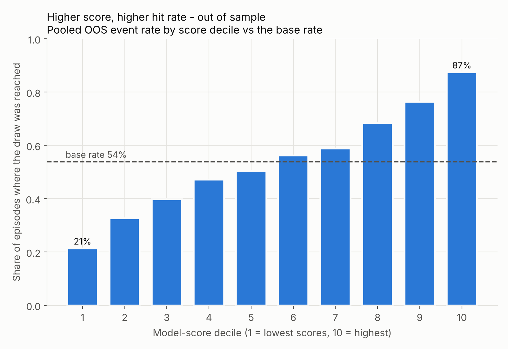
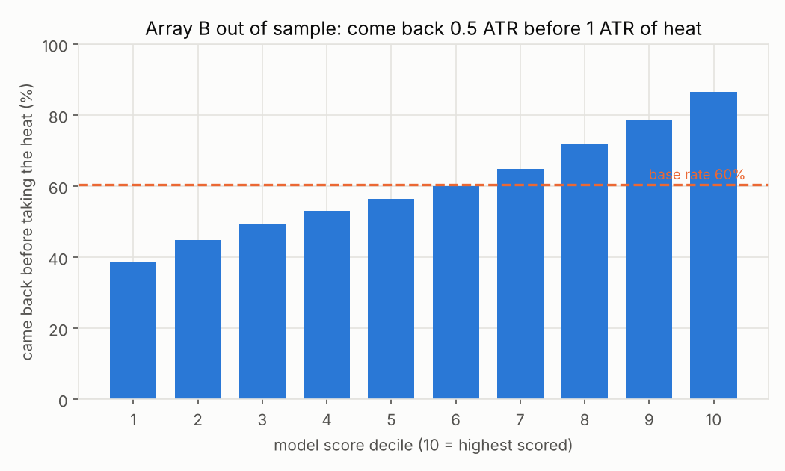

# ICT price arrays: concept models

Can a model learn which ICT price arrays actually work — without anyone hand-picking the
thresholds that decide what "works" means?

Two arrays are tested here, each on MGC (Micro Gold), each judged only on data it never saw.

| | Array | Question | Out-of-sample result |
|---|---|---|---|
| **A** | Draw on liquidity (1h) | does an untouched prior swing get reached? | AUC **0.721**, top decile 87% against a 54% base rate. A **report**, not a verdict: no thresholds were registered beforehand |
| **B** | Sweep and reversal (5m) | once a level is run, does price come back inside before taking heat? | AUC **0.673**, top-decile lift **1.50**. A **pass** on four thresholds registered in writing before the run |

Array B's documents: [METHOD_ARRAY_B.md](METHOD_ARRAY_B.md) ·
[RESULTS_ARRAY_B.md](RESULTS_ARRAY_B.md) · [thresholds.json](thresholds.json)

**The most useful finding in this repository is a negative one.** In Array B, a single raw
measurement — how far back inside the level the sweep bar itself closed — ranks at AUC 0.671
against the full twenty-input model's 0.673. Swing strength, prominence, age, times tested,
relative volume and room to the next level added about 0.001 between them. On a sweep, learned
"array quality" was worth nothing.

---

## Array A: draw on liquidity

Can a model learn which **draws on liquidity** actually get reached?

An ICT draw on liquidity is a prior swing high or low that price has not yet traded through — a
resting level that price is supposedly drawn towards. This repository trains a model to score
each such level, on 1-hour MGC (Micro Gold) bars, and tests whether the score means anything on
data the model never saw.

**It does.** Out of sample, across 13 walk-forward windows and 15,094 resolved episodes:

| | |
|---|---|
| Draws reached overall (base rate) | **53.9%** |
| Reached, among the model's **top-scored tenth** | **87.4%** |
| Reached, among the model's **bottom-scored tenth** | **21.3%** |
| Ranking (AUC) | **0.721** |
| Calibration (Brier skill vs base rate) | **+0.141** |
| Walk-forward windows with positive skill | **13 of 13** |



Every window is trained only on the 18 months before it and tested on the 6 months after, with
episodes purged so no outcome can leak across the cut. The most recent 12 months of data are
withheld entirely.

## The idea being tested

Most published ICT work specifies quality by hand: a swing must be *this* strong, a gap *this*
wide, a level *this* fresh. Those thresholds are where overfitting hides, because they are
usually chosen after seeing what works.

This model does the opposite. **Three things are fixed in advance** and never tuned — what counts
as the level being reached (traded through by at least one tick), what counts as invalidation
(the opposite swing goes first), and when the clock runs out (17:00 New York). Where both happen
inside the same minute, the episode is scored as a loss: the worst case for the trader.

**Everything else is learned.** There are no minimum sizes, no strength cutoffs, no age limits.
Swing strength, distance, age and volatility regime go in as continuous measurements and the
model decides what they are worth.

The candidate floor is deliberately the weakest usable swing — a bar higher than the single bar
on each side. Strength is measured, not filtered.

## What it learned

Distance dominates, which is partly mechanical: near levels get hit more. The interesting result
is the second-largest weight.

> **`left_strength` = +0.234.** A swing that towers over more prior bars is more likely to be
> taken out — and the effect holds in all 13 windows (+0.163 to +0.286).

That is the ICT claim about liquidity resting beyond significant highs and lows, recovered from
data rather than assumed. Meanwhile `prominence_atr` — how sharply a pivot stands above its two
immediate neighbours — is near zero. **Breadth matters; local spikiness does not.**

Full table in [RESULTS.md](RESULTS.md).

## What this is not

Read this part before using anything here.

1. **It is not a profit result.** The model predicts where price goes, not whether trading it
   makes money. There are no costs, no slippage, no fill model and no position sizing anywhere in
   this repository. A 0.72 AUC can still lose money after costs.
2. **It is not a pass or a verdict.** Pass thresholds were not registered before the run, and
   thresholds chosen after seeing results are not evidence. These numbers are a report.
3. **The base rate is high.** At 54%, guessing "it gets hit" is right more often than not. The
   evidence is the *spread* between score bands, not the level of any one of them.
4. **One market.** MGC only, 1-hour bars, 2018 to 2025.

## Repository

| Path | What it holds |
|---|---|
| [`METHOD.md`](METHOD.md), [`METHOD_ARRAY_B.md`](METHOD_ARRAY_B.md) | the definitions, features, model and evaluation in full, per array |
| [`RESULTS.md`](RESULTS.md), [`RESULTS_ARRAY_B.md`](RESULTS_ARRAY_B.md) | every number, per window and pooled, per array |
| `src/pattern_arrays/` | the labellers (`dol.py` for A, `arrayb.py` for B), the logistic regression and the walk-forward harnesses |
| `scripts/` | the runner, the chart generator and the chart-parity checks |
| `tests/` | 49 tests: hand-worked known answers, lookahead tests, and indicator checks |
| `model/` | the fitted weights |
| [`thresholds.json`](thresholds.json) | Array B's verdict thresholds, registered before the run |
| `results/` | result tables and charts |
| `tradingview/` | two Pine v6 indicators, each carrying its own fitted weights |

**No price data ships here.** The research runs on a licensed Databento feed that cannot be
redistributed. `src/pattern_arrays/data.py` documents exactly what bar format to supply.

## Running it

```bash
uv run --with pytest --with pandas --with numpy --with pyarrow python -m pytest tests -q
```

The tests need no market data — every case is a hand-built bar sequence whose correct answer is
worked out by hand in the test file's comments, including a lookahead test that perturbs all
future bars and asserts nothing before that point changes.

With your own 1-minute bars:

```bash
python scripts/pattern_arrays_stage1.py        --bars /path/to/mgc_1m.parquet   # Array A
python scripts/pattern_arrays_arrayb_stage1.py --bars /path/to/mgc_1m.parquet   # Array B
```

## On the chart

`tradingview/dol_model_mgc.pine` draws every live draw on an MGC 1-hour chart, scores it, marks
whether it was reached, and tallies a hit-rate-by-score table over the loaded history. Expected
table, computed in advance so the indicator can be checked rather than trusted:

| Model score | Episodes | Reached | Hit rate |
|---|---|---|---|
| 0–20% | 1,367 | 247 | 18% |
| 20–40% | 2,858 | 951 | 33% |
| 40–60% | 7,059 | 3,335 | 47% |
| 60–80% | 7,673 | 5,390 | 70% |
| 80–100% | 391 | 364 | 93% |
| All | 19,348 | 10,287 | 53% |

That table is in-sample — it confirms the indicator computes the model faithfully, not that the
model predicts. The out-of-sample evidence is the walk-forward above.

See [`tradingview/README.md`](tradingview/README.md) for setup.

---

## Array B: sweep and reversal

A prior 5-minute swing high or low is run — price trades through it and takes the stops resting
there. At the close of that bar: does price come back inside, or keep going?



Out of sample, over 162,099 sweeps in 13 purged walk-forward windows, asking for a close back
0.50 ATR inside the level before 1.00 ATR of heat: bottom tenth by score **38.7%**, top tenth
**86.7%**, base rate **60.4%**.

**There is no threshold in the label.** The obvious way to pose this question needs two numbers —
how far back counts as "came back", how much heat counts as "stopped out" — and those are exactly
the numbers that get chosen after seeing which ones work. So Array B records the whole surface:
for every sweep, the largest close-back achieved before each level of heat, on a fixed 6 × 5 grid
in ATR. The grid levels are then **inputs to the model**, which predicts the surface rather than
a point on it. A trader picks an operating point later, against money.

Three things are fixed in advance and never tuned: the candidate floor (the weakest usable 5m
swing), the decision time (the close of the sweep bar), and the session cap (17:00 New York).
Where a close-back and the heat land in the same minute, it is scored as a loss.

Unlike Array A, the pass thresholds were **registered in writing before the first run**
([`thresholds.json`](thresholds.json)) and all four passed: within-cell top-decile lift 1.50
(needed 1.20), pooled Brier skill +0.076 against the **per-cell** base rate (needed > 0), 13 of
13 windows positive (needed 7), surface monotone for 100% of episodes (needed 99%).

Full numbers, including the one-feature finding and the correlated-episode cross-check, in
[RESULTS_ARRAY_B.md](RESULTS_ARRAY_B.md).

`tradingview/sweep_model_mgc.pine` puts this on a 5-minute MGC chart: you choose the two numbers
from dropdowns, every sweep is scored, and the corner table tallies how often each score band
actually came back.
