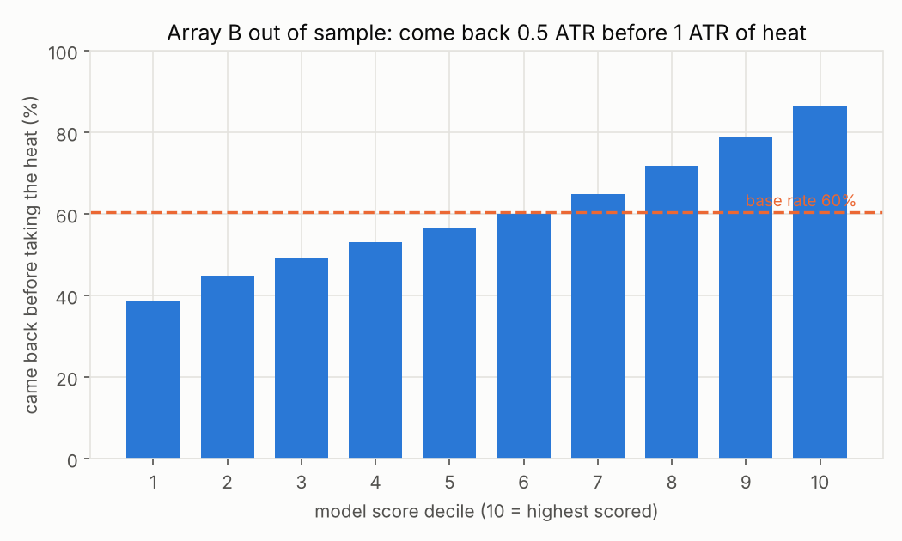
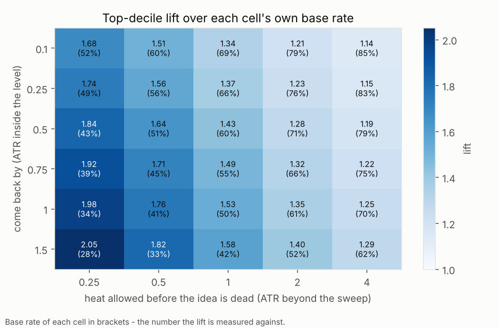
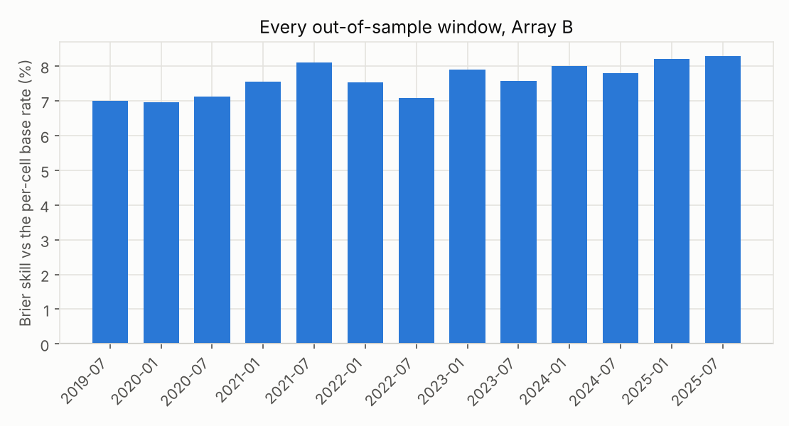

# Results — Array B: sweep and reversal (5-minute)

MGC, 5-minute bars, 2018-01-01 to 2025-10-17. The most recent 12 months of data are sealed and
were never read. Method in [METHOD_ARRAY_B.md](METHOD_ARRAY_B.md); thresholds were registered
before the run in [thresholds.json](thresholds.json).

## The verdict

All four registered tests pass.

| | test | needed | got | |
|---|---|---|---|---|
| V1 | within-cell top-decile lift | ≥ 1.20 | **1.499** | pass |
| V2 | pooled Brier skill vs the per-cell base rate | > 0 | **+0.076** | pass |
| V3 | windows with positive skill | ≥ 7 of 13 | **13 of 13** | pass |
| V4 | predicted surface monotone in x and y | ≥ 99% | **100%** | pass |

Supporting figures, pooled out of sample over 162,099 sweeps (4,862,970 cells): AUC within cells
**0.673**, log-loss skill **+0.060**, base rate 57.7%. No window was skipped for lack of data.

That chart is one cell of the grid — come back 0.50 ATR before taking 1.00 ATR of heat. Bottom
tenth by score **38.7%**, top tenth **86.7%**, against a base rate of **60.4%**.

## The result that matters more than the verdict

**The model is one measurement.**

| scored by | AUC within cells |
|---|---|
| the full 20-input model | 0.673 |
| **`close_back_frac` alone** — how far back inside the level the sweep bar closed | **0.671** |
| `minutes_to_cap` alone — time left in the session | 0.526 |
| `sweep_depth_atr` alone — how far the sweep ran | 0.425 |

Nothing is fitted in that comparison; the raw measurements are used directly as scores. The other
seventeen features add about 0.001 between them.

Everything that sounds like array quality carried nothing (weights, standardised, from the
chart-visible fit): `left_strength` +0.005, `prominence_atr` +0.008, `age_bars` −0.002,
`tests_held` +0.003, `rvol_sweep` +0.009, `room_to_opposite_atr` +0.013,
`sweep_bar_range_atr` +0.001. The weights that matter are `close_back_frac` **+0.920**, the two
grid inputs (`y_atr` +0.587, `x_atr` −0.398) and `minutes_to_cap` +0.241.

For Array A, the interesting finding was that swing strength *did* predict which levels get
taken. For Array B, swing strength predicts nothing about what happens after one is run. **How
the bar closes is the array.**

## Across the grid

Base rates run from 27.7% (come back 1.50 ATR before 0.25 ATR of heat) to 85.3% (come back
0.10 ATR before 4.00 ATR of heat). Lift runs from 1.14 to 2.05, and is **highest where the
question is hardest** — the demanding corner of the grid, where the base rate is lowest.

Ranking weakens as more is asked: AUC 0.72 at the smallest close-back, 0.62 at the largest. Some
of the model's power at the easy end is proximity rather than prediction, since a bar that
already closed back inside starts nearer the target.

## Stability

Thirteen windows, each trained on the 18 months before it and tested on the 6 months after, with
episodes purged so no outcome can cross a cut.

Brier skill by window runs 0.070 to 0.083 — every window positive, and the spread is narrow.
Per-window detail in [`results/arrayB_per_window.csv`](results/arrayB_per_window.csv).

## Correlated episodes

About 100 sweeps happen in a trading day and overlap the same price moves, so 162,099 episodes
are not 162,099 independent pieces of evidence. Recomputed on **one episode per session** — the
least correlated subset available:

| | episodes | lift | AUC | Brier skill |
|---|---|---|---|---|
| all | 162,099 | 1.499 | 0.673 | +0.076 |
| first per session | 1,530 | 1.346 | 0.741 | +0.200 |

The edge survives, and on that subset it looks stronger rather than weaker.

## Calibration

Good from 0.2 upward, overconfident below it. Predicted 8% in the lowest bin against 22%
observed; everywhere above 0.2 the predicted and observed rates track within about 2 points.
Full table in [`results/arrayB_reliability.csv`](results/arrayB_reliability.csv).

## Episode counts

197,202 sweeps, the smallest year 21,368, against a registered minimum of 500 total and 50 per
year. Swept highs 98,291 and swept lows 98,911 — even to within 0.3%.

| year | episodes | | year | episodes |
|---|---|---|---|---|
| 2018 | 24,427 | | 2022 | 25,662 |
| 2019 | 23,267 | | 2023 | 25,094 |
| 2020 | 26,151 | | 2024 | 25,817 |
| 2021 | 25,416 | | 2025 (to the seal) | 21,368 |

Dropped and counted, never half-labelled: 11,038 on no-entry sessions, 745 that swept in the
session's final bar so no decision was possible, 249 with no opposite-side pivot alive, 5
truncated at the end of data, 1 bad bar. **Zero** episodes spanned a contract roll.

## The chart version

A TradingView indicator cannot see 1-minute bars, the roll calendar or the no-entry calendar. The
whole dataset was rebuilt under those restrictions and the walk-forward re-run:

| | episodes | lift | Brier skill | AUC |
|---|---|---|---|---|
| research | 162,099 | 1.499 | +0.076 | 0.673 |
| chart-visible | 173,637 | 1.501 | +0.077 | 0.673 |

Essentially identical, for a reason worth stating: the sweep extreme is the sweep bar's extreme
either way, so the only things 1-minute data buys are the two calendars and finer tie-breaking.

The weights shipped in the indicator are fitted on the chart-visible features, so the chart
computes what it claims to. Running the Pine state machine bar by bar in Python reproduces the
table the indicator should display:

| Model score | Sweeps | Came back | Hit rate |
|---|---|---|---|
| 0–20% | 1,431 | 545 | 38% |
| 20–40% | 21,646 | 8,741 | 40% |
| 40–60% | 102,976 | 54,858 | 53% |
| 60–80% | 73,621 | 54,287 | 74% |
| 80–100% | 9,444 | 8,458 | 90% |
| All | 209,118 | 126,889 | 61% |

That table is **in-sample**. It confirms the indicator computes the model faithfully; it is not
fresh evidence. The out-of-sample evidence is the walk-forward above.

## Reading this honestly

1. **No costs.** Nothing here is a profit result. A 1.5× lift on ordering can still lose money
   after commission and slippage.
2. **The base rates are high.** At 60% in the illustrated cell, "it comes back" is right more
   often than not. The evidence is the *spread* between score bands, not the level of any band.
3. **One feature, one market, one timeframe.** The honest summary of Array B is that the close of
   the sweep bar carries information about what follows it, on MGC, on 5-minute bars, between
   2018 and 2025.
